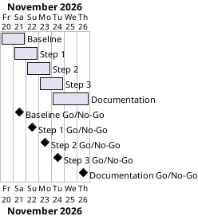

# Project Plan

## Metadata
| Key | Value |
| --- | --- |
| ID | PP-001 |
| CrossReference | [BC-001], [SA-001], [US-001], [MIL-001], [MIL-002], [MIL-003], [MIL-004], [MIL-005] |
| Language | en |
| Domain | it |

## Version History
| Date | Status | Author | Reviewer | Change | Commit |
| --- | --- | --- | --- | --- | --- |
| 2026-11-20 | Accepted | Jens Tirsvad Nielsen | S01 | Initial version | [5cdbee2] |

---

## Purpose

This plan schedules the five gateways that deliver the cafe and wifi website of [BC-001], from the baseline to the documented, three-language result, over the constraint that each step is reviewed on its own branch and pull request.

## Planning Assumptions

- Source: [BC-001] Constraints. The plan starts 2026-11-20 and ends by 2026-11-26, the duration constraint of about one week.
- One gateway is one pull request on its own branch, `mil-NNN-<slug>`, that closes the issues of its tasks.
- S01 is owner and reviewer of every gateway. In autonomous mode the review is made as stand-in for S01 and recorded as not independent.
- Python 3.13 or newer; "greater than 3.13" is read as 3.13 and above because 3.13 is the installed interpreter.
- The lecture steps of the assignment are the three feature gateways: list, add, delete.
- The use case design chain (domain model, SSD, operation contract, sequence diagram, design class diagram, ERD) per story is not planned; see Open Issues.

## Gateway Schedule

| Gateway | Document | Window | Decision date | Owner | Stories | Main deliverable | Milestone |
| --- | --- | --- | --- | --- | --- | --- | --- |
| Baseline | [MIL-001] | 2026-11-20 to 2026-11-21 | 2026-11-21 | S01 | | Repository, tooling, decisions, screenshot harness | |
| Step 1: list cafes | [MIL-002] | 2026-11-21 to 2026-11-22 | 2026-11-22 | S01 | US-001.01 | Home page lists 21 cafes | |
| Step 2: add a cafe | [MIL-003] | 2026-11-22 to 2026-11-23 | 2026-11-23 | S01 | US-001.02 | Validated add form | |
| Step 3: delete a cafe | [MIL-004] | 2026-11-23 to 2026-11-24 | 2026-11-24 | S01 | US-001.03 | Confirmed delete | |
| Documentation and wiki | [MIL-005] | 2026-11-24 to 2026-11-26 | 2026-11-26 | S01 | US-001.04, US-001.05 | README, wiki en/da/ms, reflection | |



## Scope Coverage

| Business Case scope item | Gateway |
| --- | --- |
| Website with list, add, delete | [MIL-002], [MIL-003], [MIL-004] |
| Supplied `cafes.db` in `data/` | [MIL-001], [MIL-002] |
| `constants.py`, `pyproject.toml`, `.gitignore`, `.editorconfig`, `Doxyfile` | [MIL-001] |
| README from the framework template | [MIL-001], [MIL-005] |
| Wiki in three languages with a screenshot per step | [MIL-002] to [MIL-005] |
| Screenshots in Docker | [MIL-001] to [MIL-004] |
| Opengrep before every push | [MIL-001] and every later gateway |
| Repository description and topics | [MIL-001] |

## Dependencies

```
MIL-001 -> MIL-002 -> MIL-003 -> MIL-004 -> MIL-005
```

A No-Go on a gateway moves every later date by the time of the rework; S01 decides on a move of the end date of 2026-11-26.

## Plan Risks

| Risk | Impact | Mitigation |
| --- | --- | --- |
| Docker cannot run a headless browser image | No screenshots | Stop and report (`gui-testing.md` forbids the host desktop); the harness is proven in [MIL-001] before any feature gateway starts |
| Review by a stand-in is not independent | Weak assurance | Every stand-in decision is listed in the final summary for the user to challenge |
| Wiki publishing needs the wiki enabled and an organisation secret | Wiki not published | Checked in [MIL-005] on the host |

## Open Issues

- **Design chain waiver:** the plan-first gate asks for the domain model, operation contract, sequence diagram and design class diagram of each use-case task before code. The plan does not schedule them for a three-story project. Only the Product Owner can waive them, in chat, for this request; without the waiver a design gateway has to be added before [MIL-002].
- **Presentation pattern:** [MIL-001] records MVC for the server-rendered pages instead of the MVVM default of the `clean-architecture` skill (ADR 0002); the Product Owner confirms by accepting the plan.
- **Python version:** `requires-python >= 3.13` is used; confirm that 3.14 only is not meant.
- **Data defect:** the pound sign in `data/cafes.db` is stored in a broken encoding; the plan decodes it on read and does not change the file.

---

[BC-001]: ./business-case.md
[SA-001]: ./stakeholder-analysis.md
[US-001]: ./user-stories.md
[MIL-001]: ./milestones/mil-001-baseline.md
[MIL-002]: ./milestones/mil-002-step-1-list-cafes.md
[MIL-003]: ./milestones/mil-003-step-2-add-cafe.md
[MIL-004]: ./milestones/mil-004-step-3-delete-cafe.md
[MIL-005]: ./milestones/mil-005-documentation-and-wiki.md
[5cdbee2]: https://git.tirsystem.com/Tirsvad-Udemy-100-days-of-code/088-assignment-cafe-and-wifi-website/commit/5cdbee2df2a2f92661408d724235b4d340ef3ca1
